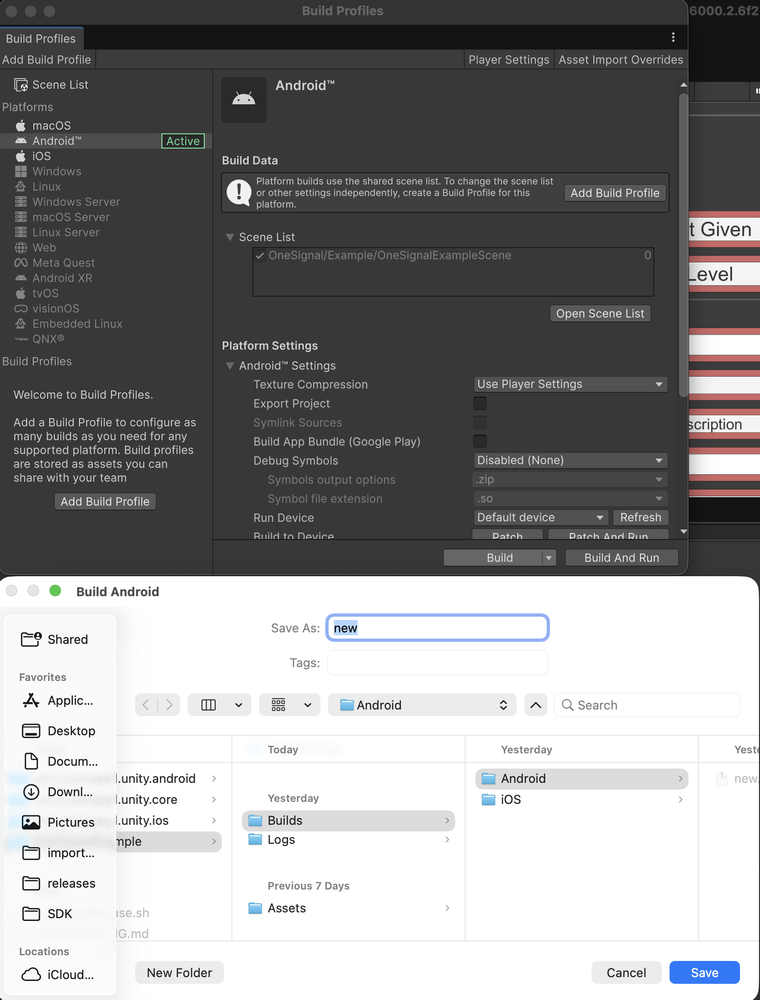
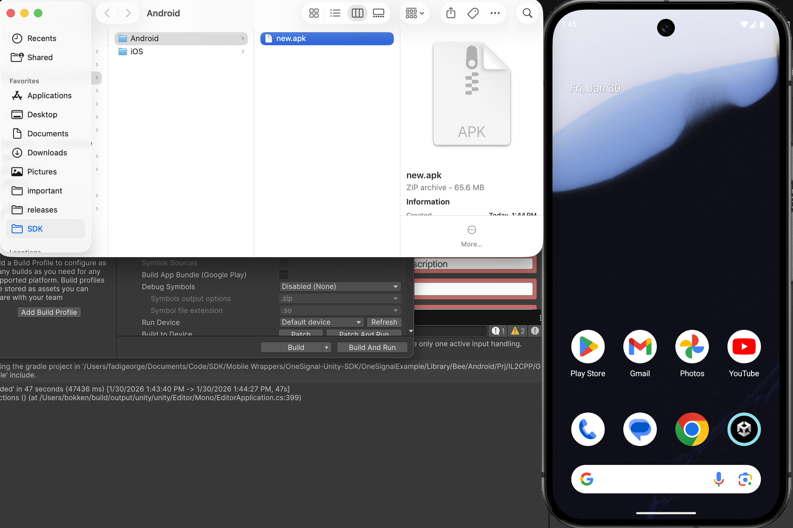
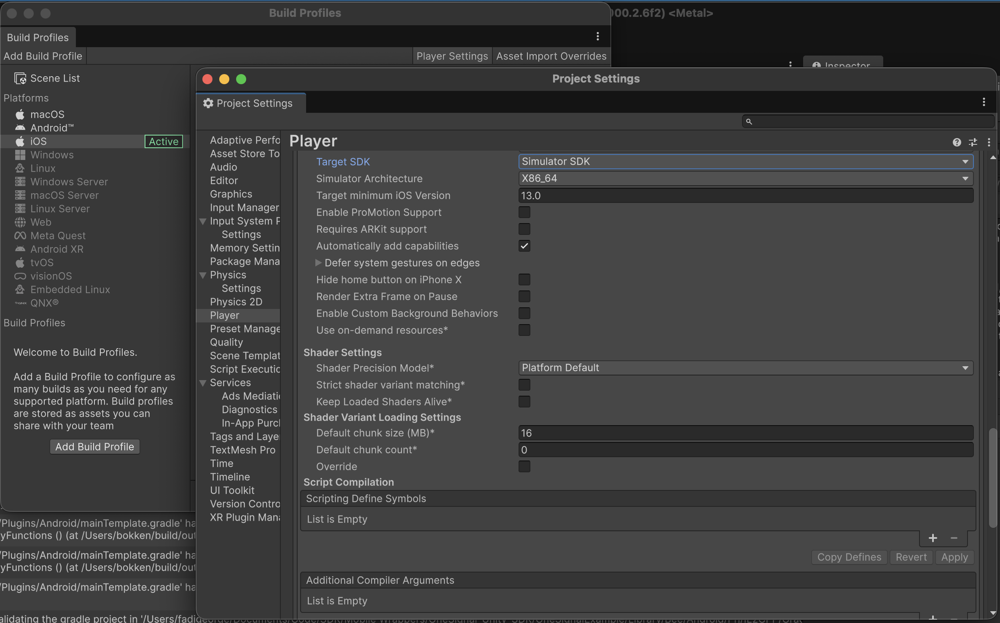
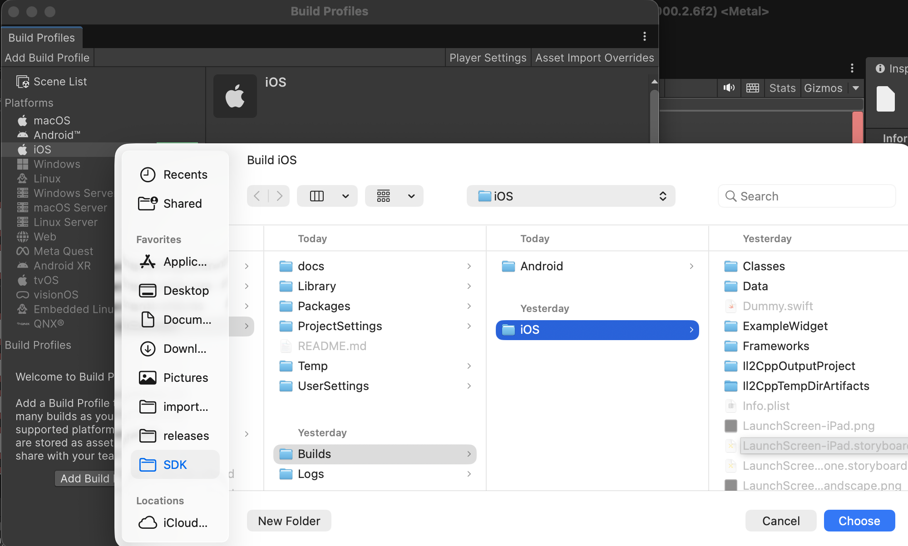

# OneSignal Unity SDK Demo

A Unity app showcasing OneSignal Unity SDK features including push notifications, in-app messaging, user management, tags, triggers, outcomes, live activities, and more. It references the in-repo UPM packages (`com.onesignal.unity.core`, `.android`, `.ios`) through `file:` paths in `Packages/manifest.json`.

The demo uses Android package `com.onesignal.sdkdemo` and iOS bundle ID `com.onesignal.example`. It is for repository development and testing. The user-facing sample is the **Full Usage** sample in `com.onesignal.unity.core/Samples~`.

## Prerequisites

- [Unity Hub](https://unity.com/download) with Unity `6000.4.11f1` (see `ProjectSettings/ProjectVersion.txt`). The project also opens in Unity 2022.3.
- Android Build Support and iOS Build Support modules
- For Android: an Android SDK with `adb` and a running emulator
- For iOS: macOS, Xcode, CocoaPods, and Rosetta 2 on Apple Silicon (`softwareupdate --install-rosetta --agree-to-license`)

## Setup

In this directory:

```sh
cp .env.example .env
```

Set your OneSignal credentials in `.env`:

```sh
ONESIGNAL_APP_ID=
ONESIGNAL_API_KEY=your_rest_api_key
E2E_MODE=false
ONESIGNAL_ANDROID_CHANNEL_ID=
```

- `ONESIGNAL_APP_ID`: required. The build fails without it.
- `ONESIGNAL_API_KEY`: REST API key, used to update and end live activities. Sending notifications from the demo doesn't need it.
- `E2E_MODE`: leave `false`. CI sets it for the Appium E2E tests.
- `ONESIGNAL_ANDROID_CHANNEL_ID`: optional Android notification channel for the sound test notification. Falls back to a built-in default channel.

Play mode in the Editor reads `.env` from this directory, and each build copies it into `Assets/StreamingAssets` (gitignored). Without `ONESIGNAL_API_KEY`, live activity update/end is disabled. Rebuild after changing `.env`.

The OneSignal app needs FCM credentials for Android and APNs credentials for the `com.onesignal.example` bundle ID on iOS.

### Firebase Installation IDs (optional)

Firebase Installation IDs are off by default. To turn them on:

1. Add a Firebase Android app for `com.onesignal.sdkdemo` and save its `google-services.json` in this directory. The file is gitignored.
2. Add `-define:FIREBASE_INSTALLATION_ID_ENABLED` to `Assets/csc.rsp`.

When `google-services.json` exists, the Android build applies the Google Services plugin. With the define set and no `google-services.json`, the Android build fails.

## Run from the command line

The scripts build without opening the Editor:

```sh
./run-android.sh
./run-ios.sh
```

- `run-android.sh` builds an ARM64 IL2CPP APK to `Build/Android/` and installs and launches it on a running emulator, prompting if several are running. Physical devices aren't supported.
- `run-ios.sh` generates a simulator Xcode project in `Build/iOS/`, runs `pod install`, builds with `xcodebuild`, and installs and launches it on a booted simulator. If none is booted, it boots the newest available iPhone.

Options:

- `--no-install`: build only
- `--install-only`: install the existing build without rebuilding
- `--open` (iOS only): open the existing `Build/iOS/Unity-iPhone.xcworkspace` without building

The scripts use the newest Unity version installed under `/Applications/Unity/Hub/Editor`. Set `UNITY_PATH` to the Unity binary to use a different one, and `ADB` or `ANDROID_HOME` if `adb` isn't found. Build logs are written to `Build/build-android.log` and `Build/build-ios.log`.

## Run from the Unity Editor

Open this directory in Unity Hub.

### Android

In **Build Profiles**, select the Android platform, click **Build**, and choose a location for the APK.



Drag the APK onto a running emulator to install it.



### iOS

In **Build Profiles**, select the iOS platform. In **Player Settings**, set **Target SDK** to **Simulator SDK**.



Click **Build and Run** and choose a location for the Xcode project, or click **Build** and run it from Xcode.



## Clean generated state

Use `clean.sh` to retest setup from the Editor or to clear build artifacts before switching dependency configurations:

```sh
./clean.sh
```

It removes Unity-generated folders such as `Build/`, `Library/`, `Temp/`, `Obj/`, `Logs/`, and `UserSettings/`. It also removes the generated OneSignal dependency manifests while keeping their `.meta` files so Unity GUIDs stay stable:

```text
Assets/OneSignal/Editor/OneSignalAndroidDependencies.xml
Assets/OneSignal/Editor/OneSignaliOSDependencies.xml
```

Reopen the project in Unity afterwards. The OneSignal Editor setup regenerates those manifests for the default location-enabled dependency set.

## Unity versions

The demo opens in Unity 2022.3 or Unity 6. The E2E workflow enables Unity 6's Accessibility module only for its automated builds, because that module isn't available in Unity 2022.3.

## Publishing to the Asset Store

For maintainers. Install the [Asset Store Tools](https://assetstore.unity.com/packages/tools/utilities/asset-store-publishing-tools-115) from **Window > Package Manager** in the Editor.

The Asset Store package is a bootstrapper, not the full demo or the UPM sample. Before publishing:

1. Select **OneSignal > Generate File Inventory**.
2. Select **OneSignal > Validate Distribution Layout** and commit the regenerated inventory.
3. Select **OneSignal > ExportUnityPackage**.
4. Inspect the exported `.unitypackage` before upload. It must contain only the bootstrap content under `Assets/OneSignal`; it must not contain `Example`, `Attribution`, packager tooling, demo assets, generated dependency XML files, or `StreamingAssets/.env`.

## Other files

- [`demo-no-location`](../demo-no-location): minimal app without the native location module
- `generate-icons.sh`: regenerates the Android and iOS app icons from the OneSignal logo
- [../build.md](../build.md): the prompts and requirements used to build this app
